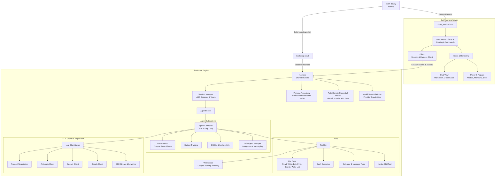

<div align="center">


# Thoth

**A generic terminal AI agent framework built in Rust**

</div>

> **Note**: Thoth is in a **very early stage** of development. APIs, features, and internals are subject to change.

Thoth is a generic terminal AI agent framework: a person talks to an AI model that can interact with a workspace through tools. Built in Rust, Thoth features a Terminal User Interface (TUI) powered by Ratatui, multi-provider LLM support, sub-agent delegation, on-demand skills, and a flexible system of configurable personas.

## Table of Contents

- [Core Concepts & Features](#core-concepts--features)
- [Project Structure & Architecture](#project-structure--architecture)
  - [Exhaustive Architecture Overview](#exhaustive-architecture-overview)
- [Development Installation & Getting Started](#development-installation--getting-started)
  - [Prerequisites](#prerequisites)
  - [Installing via Cargo](#installing-via-cargo)
  - [Building from Source](#building-from-source)
  - [Running Thoth](#running-thoth)
  - [Running Tests](#running-tests)
- [License](#license)

---

## Core Concepts & Features

- **Personas**: Named configurations stored on disk (as Markdown files with YAML frontmatter) that define an agent's identity, system prompt, model preferences, thinking level, and allowed tools and skills. You can define custom personas or delegate sub-tasks to specialized sub-agents playing different personas.
- **Terminal User Interface (TUI)**: A responsive, keyboard-driven interface built with Ratatui and Crossterm, featuring live markdown rendering, tool execution cards, syntax highlighting, and interactive pickers.
- **Agentic Tools**: Equipped with file operations (`read_file`, `write_file`, `edit_file`, `find_files`, `search_files`, `list_directory`, `walk`), command execution (`bash`), task expansion via sub-agent delegation (`delegate`, `message`), and on-demand skill loading (`invoke_skill`).
- **Multiple LLM Providers**: First-class support for leading providers including Anthropic, OpenAI, Google, and GitHub Copilot with secure credential storage and robust negotiation.
- **Smart Conversation Management**: Automatic budget tracking, conversation compaction (summarizing old turns when context limits approach), and tool output elision to keep token usage efficient.
- **Modular Rust Architecture**: Clean separation into core engine logic (`thoth-core`), terminal interface (`thoth-terminal`), and binary entry point (`thoth`).

---

## Project Structure & Architecture

Thoth is organized as a Cargo workspace with three primary crates:

- **`crates/core` (`thoth-core`)**: The agent engine, conversation management, persona repository, LLM clients, tool definitions, authentication, and session persistence.
- **`crates/terminal` (`thoth-terminal`)**: The Ratatui-based TUI application, rendering engine, chat views, pickers, and user interaction handlers.
- **`crates/thoth` (`thoth`)**: The top-level binary crate that initializes the harness and boots the terminal UI.

### Exhaustive Architecture Overview



---

## Development Installation & Getting Started

### Prerequisites

Thoth requires **Rust 1.89+** (Edition 2024) and Cargo. You can install Rust via [rustup](https://rustup.rs/):

```bash
rustup update stable
```

### Installing via Cargo

You can install Thoth directly from the GitHub repository using Cargo:

```bash
cargo install --git https://github.com/mahmok/thoth.git thoth
```

### Building from Source

Clone the repository and build the workspace in release mode:

```bash
git clone https://github.com/mahmok/thoth.git
cd thoth
cargo build --release
```

The compiled binary will be available at `target/release/thoth`.

### Running Thoth

To start the terminal application directly using Cargo:

```bash
cargo run
```

Or run the built binary:

```bash
./target/release/thoth
```

### Running Tests

To run the test suite across all workspace crates:

```bash
cargo test
```

---

## License

This project is licensed under the MIT License - see the [LICENSE](LICENSE) file for details.
